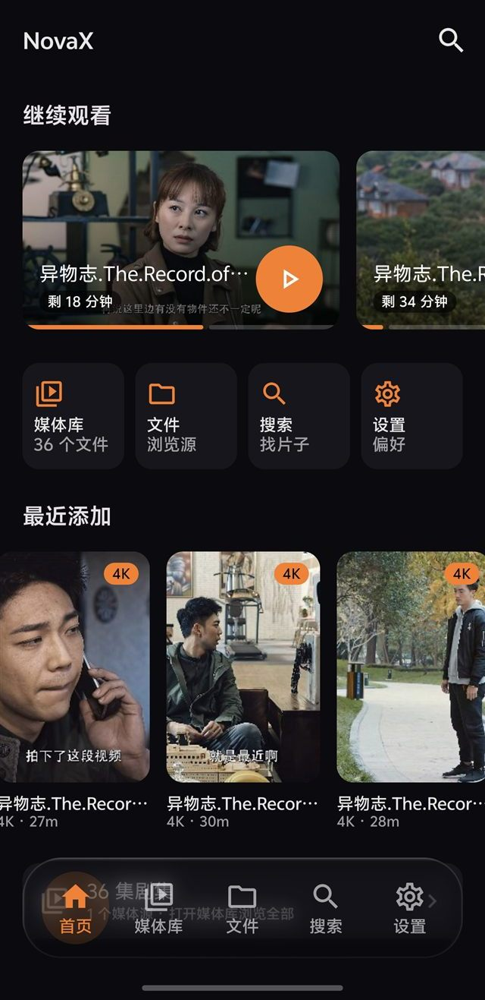
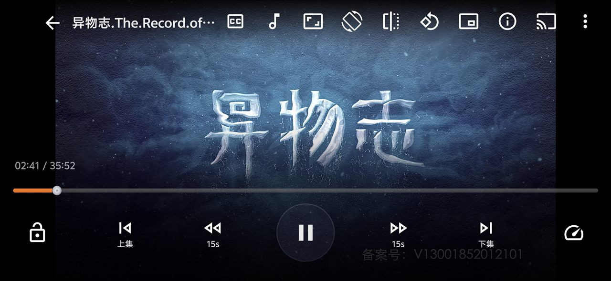
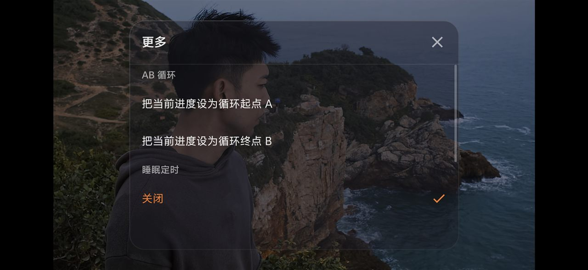

中文 | [English](README.en.md)

# NovaX Player

Android 本地与网络视频播放器。支持 SMB、SFTP、WebDAV、Jellyfin 和本地存储，ExoPlayer 与 libVLC 双内核，带 DLNA 投屏，数据全部保存在设备本地。

[](https://github.com/liuyouwu1999/NovaX-Player/releases)
[](LICENSE)

-green)

[下载安装](#下载安装) · [功能](#功能) · [操作手势](#操作手势) · [从源码构建](#从源码构建) · [参与贡献](#参与贡献) · [许可证](#许可证)

## 下载安装

前往 [Releases](https://github.com/liuyouwu1999/NovaX-Player/releases) 页面下载最新 APK。安装包按架构拆分，减小体积：

| 文件 | 适用设备 |
|---|---|
| `NovaX-<版本>-arm64-v8a.apk` | 近年的手机和平板，不确定就选这个 |
| `NovaX-<版本>-armeabi-v7a.apk` | 较老的 32 位设备 |
| `NovaX-<版本>-x86_64.apk` | 模拟器、Chromebook |

系统要求 Android 8.0（API 26）及以上。每个 Release 附有 SHA-256 校验和，下载后可以比对。

## 功能

媒体源：

- 支持 SMB、SFTP、WebDAV、Jellyfin 和本地存储，添加一次长期使用
- NAS 口令经 Android Keystore（AES-256-GCM）加密后保存，不存明文（极少数机型 Keystore 不可用时除外）

播放：

- 双内核：ExoPlayer（Media3）为主，RM、RMVB 等私有容器自动切换到 libVLC
- FFmpeg 音频软解：AC3、E-AC3（JOC）、DTS（DTS-HD）、TrueHD 无声时自动降级软解并记住选择
- 播放记忆、倍速、音画偏移、字幕偏移、卡顿自动恢复、断线重连

投屏：

- 内置 DLNA / UPnP 渲染器发现与推流，本地和 NAS 里的视频可以推到电视上放

其他：

- 缩略图缓存、文件夹海报墙、TMDB 刮削（API Key 自己在设置里填）
- 画中画、后台播放、通知栏控制、横竖屏跟随系统

本应用不接入统计、广告或上报 SDK，媒体库、播放记录和源配置只存在设备本地。

## 操作手势

播放操作按大众常用视频应用的交互逻辑设计，用过主流视频 App 就能直接上手，每个参数都能在「设置 → 播放器」里调整：

- 双击快进快退：屏幕左 1/5 双击快退，右 1/5 双击快进，默认 ±15 秒，可选 10、15、25、30 秒，连击累加；中部双击播放暂停
- 长按倍速：按住提速，默认 2x，0.5 到 3x 六档可调，松手恢复原速；长按期间下滑锁定倍速，拖进度条不会中断。3x 自动静音默认关闭，可在设置中开启
- 双指捏合缩放画面，可以平移看细节
- 横向滑动调进度，按片长百分比计算（默认整屏 10%），长视频不跳变
- 单击呼出或收起控制层；一键锁屏锁定全部手势，防止口袋误触
- 另有 AB 循环、睡眠定时、音画和字幕偏移微调

## 界面预览

| 首页 | 媒体库 | 搜索页 | 深色主题 |
|:---:|:---:|:---:|:---:|
|  |  |  |  |

播放器与播放菜单：





浅色和深色主题都支持，跟随系统自动切换。

## 从源码构建

需要 Android Studio 与 Android Gradle 插件 9.1+、JDK 17+、Android SDK（compileSdk 37）和 NDK / CMake，最低支持 Android 8.0。

```bash
git clone https://github.com/liuyouwu1999/NovaX-Player.git
cd NovaX-Player
# Android Studio 打开自动生成 local.properties，或者命令行：
./gradlew :app:assembleDebug
```

FFmpeg 扩展的头文件和各 ABI 预编译静态库已随仓库分发，克隆下来就能构建。要重编 FFmpeg 本体，参考 [FFmpeg 官方文档](https://ffmpeg.org/documentation.html) 自行准备源码树。

debug 构建的演示模式会播放 `app/src/debug/assets/sample.mp4`（演示片源不入库），放一个任意 MP4 改成这个名字就行。

## 参与贡献

欢迎提 Issue 反馈 bug 和功能建议。PR 请先开 Issue 讨论方案，提交信息建议遵循 [Conventional Commits](https://www.conventionalcommits.org/zh-hans/)。

## 完全免费，禁止倒卖

NovaX Player 完全免费，官方发布渠道只有本仓库和仓库的 [Releases](https://github.com/liuyouwu1999/NovaX-Player/releases) 页面。

任何应用商店、网站或个人以付费形式销售、捆绑或变相收费分发本软件，都是冒用开发者名义的诈骗，与开发者无关。请不要付费下载；遇到了欢迎向发布渠道举报，或者提 [Issue](https://github.com/liuyouwu1999/NovaX-Player/issues) 告知。

## 免责声明

本软件按「现状」提供，不附带任何明示或默示的担保。在法律允许的最大范围内，开发者不对您因使用或无法使用本软件造成的任何直接或间接损失承担责任。

本软件只提供本地和局域网文件的播放能力，不提供、不存储、不推荐任何内容。播放内容的来源和合法性由您自行负责，请遵守所在地区的法律法规。

## 第三方组件

| 组件 | 用途 | 许可证 |
|---|---|---|
| [AndroidX Media3 / ExoPlayer](https://github.com/androidx/media) | 主播放内核 | Apache-2.0 |
| [libVLC](https://code.videolan.org/videolan/libvlc-android)（VLC 4 EAP） | RM/RMVB 兜底内核 | LGPL-2.1+ |
| [FFmpeg](https://ffmpeg.org) | 音频软解 | LGPL-2.1+（预编译库随仓库分发） |
| [jcifs-ng](https://github.com/AgNO3/jcifs-ng) / [smbj](https://github.com/hierynomus/smbj) | SMB 客户端 | LGPL-2.1 / Apache-2.0 |
| [sshj](https://github.com/hierynomus/sshj) | SFTP 客户端 | Apache-2.0 |
| [Jetty](https://github.com/jetty/jetty.project) | 投屏流服务 | Apache-2.0 / EPL |
| [jUPnP](https://github.com/jUPnP/jUPnP) | DLNA / UPnP | CDDL-1.0 |
| [OkHttp](https://github.com/square/okhttp)、[Coil](https://github.com/coil-kt/coil)、[Haze](https://github.com/chrisbanes/haze)、pinyin4j、SLF4J 及 Jetpack / AndroidX 组件 | 网络与 UI 基础 | Apache-2.0 / BSD / MIT |

以上组件的版权归各自作者所有，感谢开源社区。

## 许可证

本项目以 [GNU GPL v3](LICENSE) 协议开源。衍生作品需要以同协议开源并保留版权声明。

Copyright © 2026 NovaX Dev
